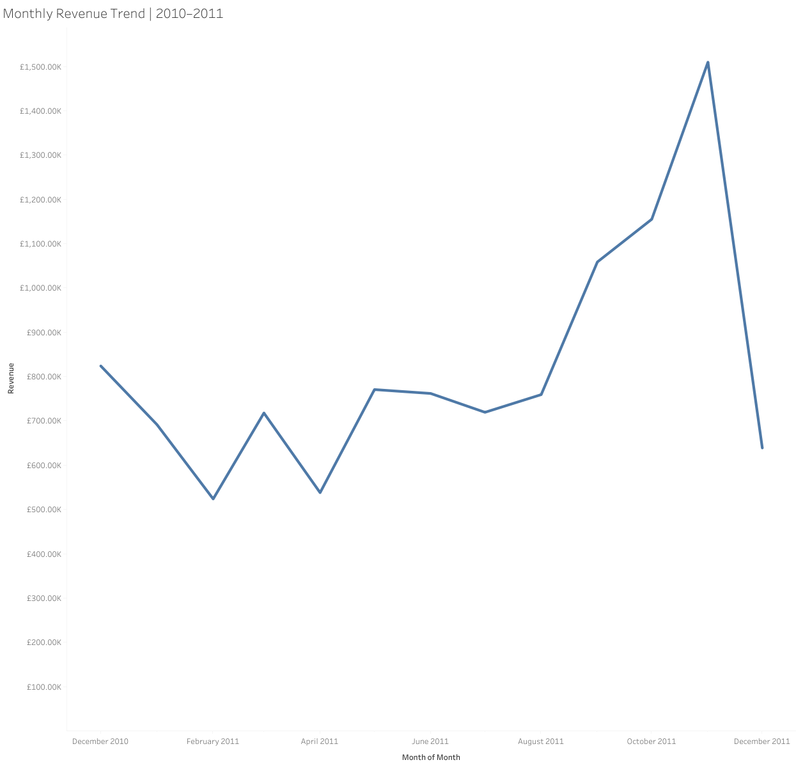
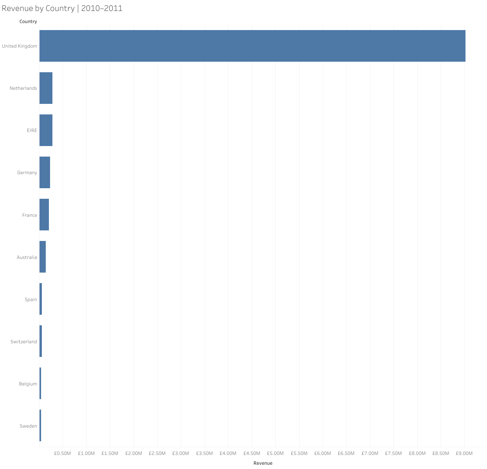

# Online Retail Sales Analysis

## Overview

A data analysis project using real transaction data from the UCI Online Retail dataset (2010–2011).

The goal is to analyze sales performance, customer purchasing behavior, and revenue trends using Python and PostgreSQL.

## Tools

- Python (pandas) — data cleaning
- PostgreSQL — SQL analysis
- pgAdmin — running SQL queries

## Data Preparation

The original dataset contains 541,909 transaction line items.

Using pandas, I checked missing values, duplicates, negative quantities, cancelled invoices, and invalid prices.

For the sales analysis, I excluded cancelled invoices, nonpositive quantities and prices, and invalid dates. Missing customer IDs and duplicate rows were retained.

The cleaned dataset was then imported into PostgreSQL.

## Analysis

The SQL queries cover:

- Total revenue and number of orders
- Monthly revenue trends
- Top products and countries by revenue
- Highest-spending customers
- Repeat customers
- Average order value

## Key Findings

- **Revenue:** Positive sales amount to approximately £10.7 million across around 20,000 invoices. This is before accounting for returns against earlier purchases.
- **Geographical performance:** The United Kingdom dominates sales, contributing roughly 85% of positive-sales revenue. This shows how heavily the business depends on its domestic market.
- **Monthly trends:** November 2011 was the strongest complete month. Sales increased considerably in the months leading up to the Christmas period.
- **Data quality:** Around 25% of the original records have missing customer IDs. These transactions can be included in sales totals, but not in individual customer analysis.
- **Product performance:** Some of the highest-revenue product descriptions are actually shipping charges, such as DOTCOM POSTAGE. These should be separated from physical products when analyzing merchandise performance.

## Visualizations

### Monthly Revenue

### Revenue by Country

## Data Limitations

The analysis focuses on positive sales and doesn't calculate net revenue after returns and cancellations.

Some original purchases may have been cancelled later, potentially overstating revenue. Missing customer IDs limit customer-level analysis, and exact duplicate rows were retained.

December 2011 contains only nine days of data, so it shouldn't be compared directly with complete months.

## Dataset

UCI Machine Learning Repository — Online Retail

https://archive.ics.uci.edu/dataset/352/online+retail

## Project Structure

- `clean_data.py` — data preparation with pandas
- `sql/01_create_table.sql` — PostgreSQL table definition
- `sql/02_sales_analysis.sql` — sales analysis queries
- `sql/03_customer_analysis.sql` — customer analysis queries
